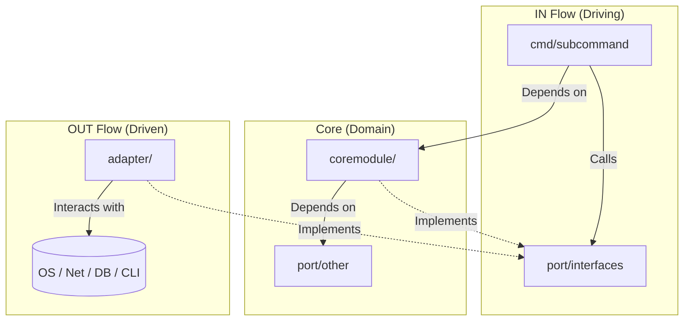

# ARCHITECTURE.md

## System Overview
This application is a Command-Line Interface (CLI) tool built in Go, strictly adhering to **Hexagonal Architecture (Ports and Adapters)**. The architecture enforces a hard boundary between the core business logic and all external concerns (CLI parsing, file system, network, OS calls, third-party frameworks). 

The system consists of a pure **Core** (business logic) surrounded by **Ports** (interfaces defining communication boundaries) and **Adapters** (implementations handling actual I/O and external integrations).

## Directory Structure

```text
./
├── main.go                          # Composition root. Wires dependencies, launches CLI.
├── cmd/                             # IN Flow Adapters (CLI Layer)
│   └── <subcommand>/
│       └── <subcommand>.go          # Cobra command definition, flag parsing, stdout formatting.
├── port/                            # Port Definitions (Contracts & Messages)
│   └── <portname>/
│       └── <portname>.go            # Interfaces and DTOs/Messages. ZERO implementation logic.
├── adapter/                         # OUT Flow Adapters (Infrastructure & I/O)
│   └── <adaptername>/
│       └── <adaptername>.go         # Implements ports. Allowed to use OS, Net, DB, heavy libs.
├── coremodule/                      # Core Business Logic (Domain Layer)
│   └── <coremodule>/
│       ├── <coremodule>.go          # Pure business logic. NO OS, Net, or heavy framework imports.
│       ├── validate.go              # Pure validation functions for boundary data.
│       └── convert.go               # Pure mapping/conversion functions between domain models.
```

## Component Breakdown

### 1. Bootstrap (`main.go`)
* **Role**: The Composition Root.
* **Responsibilities**: Instantiates adapters, injects them into core modules, injects core modules into CLI commands, and executes the Cobra root command. 
* **Constraint**: Contains **zero** domain or business logic. It is purely glue code.

### 2. CLI Commands (`cmd/`)
* **Role**: IN Flow Adapters.
* **Responsibilities**: Translates user input (flags, arguments, stdin) into domain messages. Invokes the core module via its port interface. Formats core responses for standard output (stdout, stderr, exit codes).

### 3. Ports (`port/`)
* **Role**: The Contract Layer.
* **Responsibilities**: Defines Go interfaces and the exact data structures (messages/DTOs) passed across architectural boundaries. 
* **Constraint**: Contains **no** implementation code.

### 4. Adapters (`adapter/`)
* **Role**: OUT Flow Adapters.
* **Responsibilities**: Implements the interfaces defined in `port/`. 
* **Constraint**: This is the **only** directory allowed to import `os`, `net`, `database/sql`, `io`, or heavy third-party frameworks. It translates external I/O into domain messages.

### 5. Core Modules (`coremodule/`)
* **Role**: The Domain/Business Logic.
* **Responsibilities**: Implements business rules and orchestration. May depend on other ports to fetch data or save state.
* **Constraint**: Must remain completely agnostic to *how* ports are implemented. **Never** imports infrastructure or I/O packages.

## Dependency Flow


*Rule of thumb:* Dependencies always point **inward** toward the core. The core never knows about the adapters or the CLI framework.
